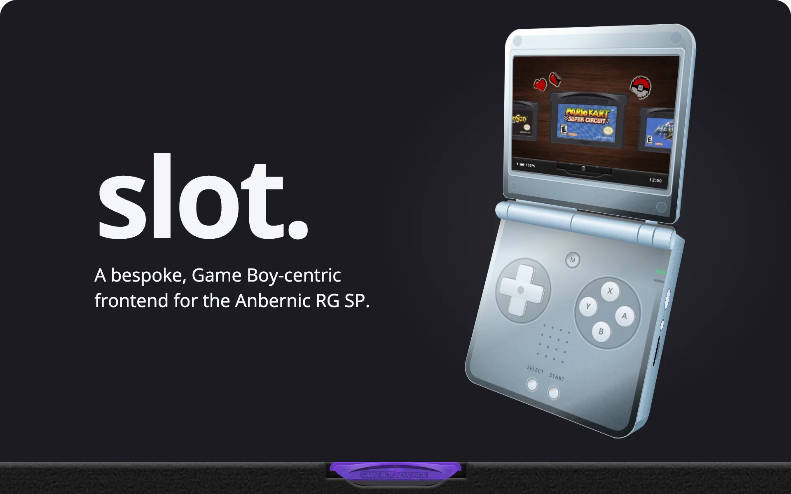
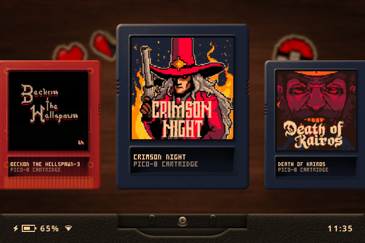
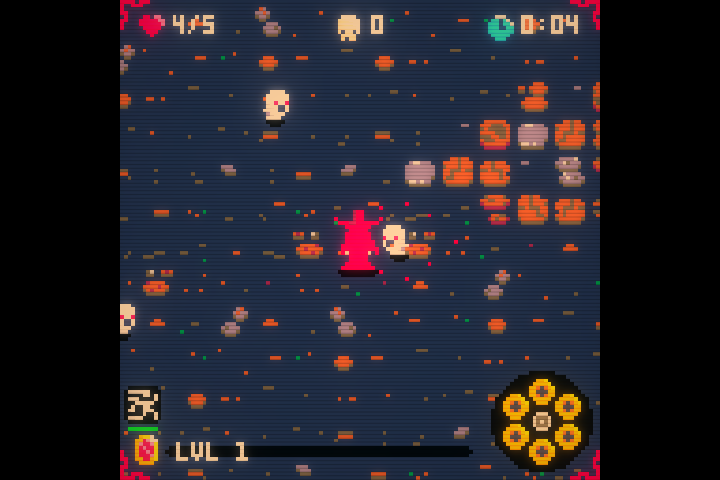
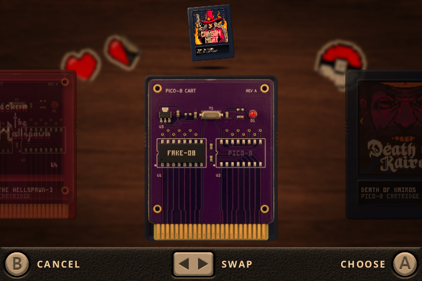
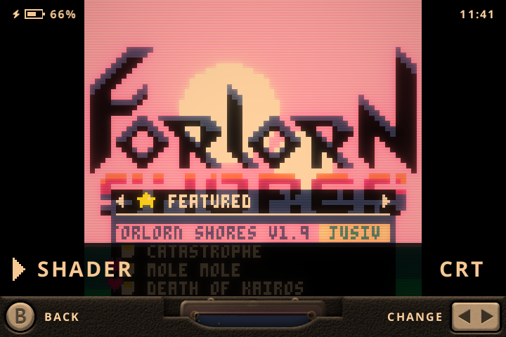
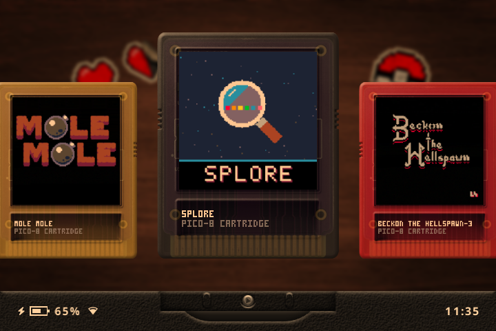
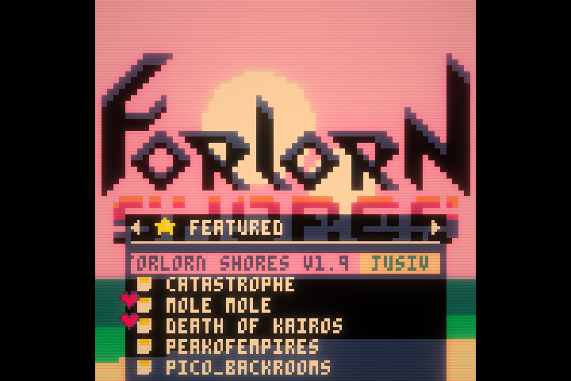

---

# slot, with PICO-8

This is a fork of [slot](https://github.com/slot-cfw/slot) that adds [PICO-8](https://www.lexaloffle.com/pico-8.php)
as a system of its own. PICO-8 carts get their own shelf, their own cart, their own board and their own
shaders, and play like any other game in slot.

Everything else is slot as it is: the Game Boy, Game Boy Color and Game Boy Advance shelves work exactly the same.
Releases follow slot's version with a number added: 1.16.0.7, for example, is slot 1.16.0 with the seventh PICO-8 release on top.

## What you get

- **A PICO-8 shelf.** Drop `.p8` and `.p8.png` carts in `Games/PICO8/`. Each one becomes a cart made like the printed
  carts PICO-8 fans make: the label from the cart itself in a square window, its name in PICO-8's letters underneath.
  Press <kbd>SELECT</kbd> to give one a different shell in Cart Studio, like any other cart.
- **Plays out of the box on [fake-08](https://github.com/jtothebell/fake-08).** fake-08 is a free PICO-8 core that comes
  with this fork, so you don't need to own anything. Carts go into the slot with the same insert animation, and you get
  slot's in-game menu, save states and screenshots.
- **Or on your own PICO-8.** If you bought PICO-8, put it on the card and flip any cart over to its purple board to
  pick the PICO-8 chip instead of fake-08. slot steps aside while PICO-8 runs, but <kbd>MENU</kbd> still opens
  slot's menu over it, holding <kbd>MENU</kbd> quits back to the same cart, and the lid and power button work as usual.
- **Splore.** With your own PICO-8 on the card, a Splore cart shows up on the shelf. It opens PICO-8's browser for the
  [Lexaloffle BBS](https://www.lexaloffle.com/bbs/?cat=7) over the Wi-Fi you saved in slot. Every cart you favourite
  there lands on your shelf when you leave, where it also plays on fake-08.
- **PICO-8's shaders.** Grid, Shimmerless and CRT, on fake-08 and on your own PICO-8 alike. CRT gives every row a soft
  scanline and bright pixels a glow. Pick one under Settings → Screen → PICO-8, or from the menu while you play.
- **One set of saves.** Game saves, like high scores, live in `Saves/PICO8/cdata/` for both cores, so a game you
  started on fake-08 carries on on PICO-8 and back.

## Installing

Install it like slot (see [Installing slot](https://slot-cfw.fyi/installing/)), but take the zip from
[this fork's latest release](https://github.com/keeponjammin/slot-pico/releases/latest) instead of slot's.

Already on slot? Unzip the release and copy its contents onto the root of your card, over what's there. Your games,
saves and settings stay. From then on, Network → Check for Updates looks at this fork's releases, so you stay on it.

Then put your carts in `Games/PICO8/` and turn the device on. A PICO-8 shelf appears.

## Setting up Splore

Splore is part of PICO-8 itself, so it only shows up once your own copy of PICO-8 is on the card.
PICO-8 is not free: buy it from [Lexaloffle](https://www.lexaloffle.com/pico-8.php), which licenses it per person.

1. Log in to your Lexaloffle account and download the **Raspberry Pi** build of PICO-8, for example
   `pico-8_0.2.7_raspi.zip`. That's the one that runs on these handhelds.
2. Copy the zip, as it is, into `BIOS/PICO-8/` on the card. Unzipping it there yourself is fine too, as long as
   `pico8_dyn` and `pico8.dat` end up directly in `BIOS/PICO-8/`.
3. Save a Wi-Fi network in slot: open the menu on the shelf and pick Network → Scan for Networks.
4. Turn the device on. A **Splore** cart is on the PICO-8 shelf, and the PICO-8 chip on each cart's board can be picked.
   slot unpacks the zip the first time you play something on it.

Splore turns the Wi-Fi on when it starts and off when you leave. You don't need to install anything else: BaseOS's own
`wget` can't reach the BBS, so slot does PICO-8's downloads for it.

Without PICO-8 on the card, Splore stays off the shelf and every cart plays on fake-08.

The [PICO-8 guide](site/docs/guide/pico-8.md) has the buttons, folders and the rest of the details.
